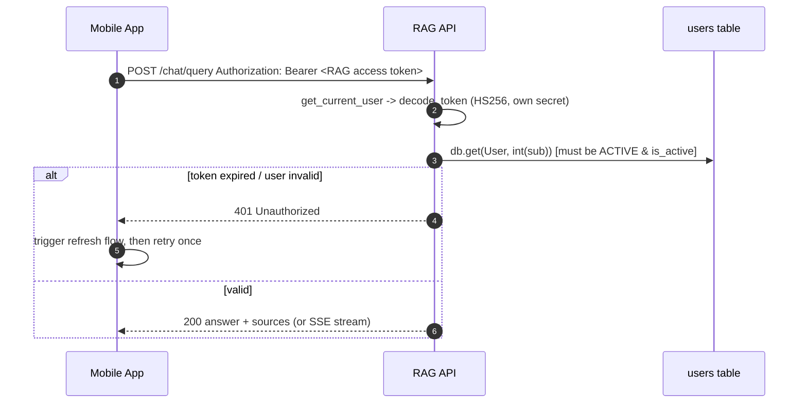

# Employee Zone SSO — Auth/Identity Design for the RAG Knowledge Base API

Scope: design how the existing FastAPI "RAG Knowledge Base API" should **accept and trust** the
identity of an employee who is already authenticated in the company **Employee Zone** mobile app,
so there is **no second email/password login**. This is a **spec/design only** document; no
application code is modified here. Every claim is grounded in the current source audited in
`docs/employee-zone/01-current-state.md`.

Confirmed constraints carried forward from the audit:

- The native mobile app calls the RAG API **directly** (no backend proxy in front of the RAG API).
- Employees **only ask questions** (chat/search); they never upload (`POST /documents/upload` is to be blocked for the employee role per audit §4/§7).
- Current auth is a **self-issued HS256 JWT**: `{"sub": str(user_id), "role": role, "exp": expire}` minted by `create_access_token` (`backend/app/core/security.py:65-76`), decoded with the same shared secret (`backend/app/core/security.py:79-82`).
- Tokens last **720 min / 12h** (`ACCESS_TOKEN_EXPIRE_MINUTES`, `backend/app/core/config.py:100`); **no refresh token** exists (audit §1).
- `get_current_user` (`backend/app/core/security.py:86-96` → `_resolve_user_from_token`, `:105-127`) **requires a `users`-table row**: it does `int(sub)` then `db.get(User, user_id)` and rejects missing / `status != ACTIVE` / `is_active == False` with 401.

The headline problem (audit §1 closing): *the API today only trusts JWTs it issued itself (HS256
with its own secret), against its own users table. There is no way to trust an external SSO
identity; an Employee Zone-issued token would not validate, and there is no JIT user-provisioning
path.* This document closes that gap **additively and back-compatibly**.

---

## 1. Trust models considered

Three concrete models for how the RAG API can come to trust an Employee Zone identity.

### Option A — Token exchange (RAG-minted token)

The RAG API exposes a new `POST /auth/sso-exchange`. The mobile app sends its Employee Zone (EZ)
token; the RAG API verifies it once, JIT-provisions/reconciles a `users` row, and returns a
**RAG-issued access token** (the existing HS256 token, unchanged format). All subsequent
`/chat/*` and `/search` calls use that RAG token, so `get_current_user` works **untouched** —
the RAG token still carries `sub = str(user.id)` and resolves against the users table exactly as
today (`backend/app/core/security.py:116-127`).

- **Pros.** Minimal blast radius: the hot path (`get_current_user` on every chat request) is
  unchanged and still does a single `db.get(User, id)` — no per-request external verification,
  no JWKS fetch on the request path. Works regardless of whether EZ tokens are HS- or RS-signed.
  The RAG token is a clean internal credential we fully control (revocation, expiry, claims).
  EZ verification cost is paid **once per exchange**, not per request.
- **Cons.** Two token lifetimes to reason about (EZ session vs RAG token); needs a documented
  **re-exchange** step when the RAG token nears expiry. Introduces a small refresh surface.

### Option B — OIDC / JWKS direct verification (no RAG token)

The RAG API verifies the **EZ/IdP-issued JWT directly** on every request against the IdP's JWKS
(RS256), checking `iss`, `aud`, `exp`, signature, with clock skew tolerance and JWKS key
rotation. There is **no separate RAG token**; the mobile app just sends its IdP token as the
bearer. A new dependency `get_current_employee` verifies the external token, then JIT-provisions/
reconciles the users row and returns the `User`.

- **Pros.** Single source of truth for session lifetime (the IdP). No second token to refresh —
  when EZ refreshes the IdP token, the new token "just works." Cleanest if the company has a
  **real IdP** (Azure AD / Entra ID, Okta, Auth0, Keycloak, Google Workspace) exposing a
  standard `/.well-known/openid-configuration` + JWKS.
- **Cons.** Per-request external verification (mitigated by **caching the JWKS**, not the token —
  signature verification is local CPU, the network hit is only on key rotation). Requires the EZ
  token to be a real OIDC/JWT with stable `iss`/`aud`/`kid` and an RS256 (asymmetric) signature
  the RAG API can verify with public keys. The current code is **HS256-only**
  (`backend/app/core/security.py:82`), so this adds an asymmetric verification path. We must also
  decide audience: the EZ access token's `aud` must include the RAG API, or we accept the IdP's
  ID-token audience — audience confusion risk (see §6).

### Option C — Service-to-service API key + signed employee-identity header

A trusted backend proxy authenticates to the RAG API with a shared **service API key** and asserts
the employee identity in a signed header (e.g. `X-Employee-Identity: <jwt|hmac>` plus
`X-RAG-Service-Key`). The RAG API trusts the header **only** because the connection is
authenticated by the service key.

- **Pros.** Simple internal trust; the RAG API never has to verify an end-user token.
- **Cons.** **Only valid if a backend proxy exists.** The confirmed constraint is the **native
  mobile app calls the RAG API directly** — there is no proxy. Putting a service key in the mobile
  client is a hard no (audit §6 / §6 below: "no secrets in the mobile client"). **Rejected for
  this deployment.** Documented only so the option is on record for a future proxied topology.

### Recommendation — **Option A (token exchange), PRIMARY**, with a clear path to B

For a **native mobile frontend calling the RAG API directly**, Option A is recommended.

Decisive reasons, grounded in the code:

1. **Smallest, safest change to the hot path.** Every chat/search request runs `get_current_user`
   (`backend/app/core/security.py:86`) which today decodes a token and does one `db.get(User, id)`
   (`:124`). Option A keeps that path **byte-for-byte** — the RAG token is still our HS256 token
   with `sub = user.id`. We add verification logic in **one new endpoint**, not on every request.
   The audit explicitly lists "trust an external token" + "JIT provisioning" as the work (audit
   §7a items 1–2); Option A localizes both.
2. **Provider-agnostic.** Option A works whether the EZ token is a real OIDC RS256 JWT, an
   opaque token validated via an EZ introspection endpoint, or an HS256 token shared with us. We
   are not yet certain EZ exposes a standards-compliant JWKS; Option A does not require it.
3. **Full control of the credential the mobile client holds long-term.** The RAG token is short,
   scoped, and revocable on our side, independent of the EZ session.
4. **B is strictly better only with a real IdP** and a token whose `aud` we can pin to the RAG
   API. We therefore design Option A so that its verification step is **pluggable**: the same
   `_verify_employee_zone_token` function can do JWKS/RS256 verification (the Option B core). If
   the company confirms a real IdP with RAG as a registered audience, we can **flip to Option B**
   (drop the RAG token, point the bearer dependency at the IdP token) by reusing the same
   verifier — see §2 "evolution to B."

**Net:** ship Option A now; keep the verifier shaped so Option B is a configuration/topology
change later, not a rewrite.

---

## 2. Recommended design (Option A) in detail

### 2.1 What the mobile app does

1. Employee is already logged into Employee Zone → EZ holds a valid **EZ token** (the IdP/EZ
   access or ID token).
2. On first RAG use (or when the RAG token is missing/expired), the app calls
   `POST /auth/sso-exchange` with the EZ token.
3. RAG API verifies the EZ token, JIT-provisions/reconciles a `users` row, mints a **short-lived
   RAG access token** + a **RAG refresh token**, returns both.
4. App uses the RAG access token as `Authorization: Bearer` for all `/chat/*` and `/search`
   calls — **no change to those endpoints**.

### 2.2 EZ token verification details

These are the checks `_verify_employee_zone_token(raw_token) -> EmployeeClaims` performs inside the
exchange endpoint. Two verification profiles, selected by config; both are additive and never run
unless SSO is configured.

**Profile 1 — Asymmetric / OIDC (preferred, RS256 + JWKS):**

- **Algorithm:** `RS256` (asymmetric). Pin the allowed algorithms explicitly to `["RS256"]` (never
  accept `none`, never accept HS* with a public key — classic alg-confusion attack). This is a new
  path; the existing internal decode stays HS256 (`backend/app/core/security.py:82`).
- **Signature / keys:** fetch the IdP JWKS from `SSO_JWKS_URL`, select the key by the token's
  `kid` header. **Cache the JWKS** in-process with a TTL (e.g. 10 min) and **refresh on
  `kid` miss** (handles key rotation without a restart). Never trust a token whose `kid` is absent
  from the (freshly refreshed) JWKS.
- **Issuer:** require `iss == SSO_ISSUER` (exact match).
- **Audience:** require `SSO_AUDIENCE` to be present in the token's `aud` claim (string or array).
  This is the guard against **audience confusion** — a token minted for another EZ service must
  not be accepted by the RAG API.
- **Expiry / not-before:** verify `exp` (reject expired) and `nbf`/`iat` if present.
- **Clock skew:** allow a small leeway, `SSO_CLOCK_SKEW_SECONDS` (default 60s), on `exp`/`nbf`/
  `iat` to tolerate device/server clock drift.
- **Subject / identity claims:** read a **stable** subject — preferred order: `employee_id`
  (a configurable claim name, `SSO_EMPLOYEE_ID_CLAIM`), else `sub`. Read `email` (required for
  provisioning/reconciliation) and optional `name`.

**Profile 2 — Symmetric (fallback, only if EZ cannot expose JWKS):**

- Verify HS256 with `EMPLOYEE_ZONE_SHARED_SECRET` (a secret shared out-of-band between EZ and the
  RAG API, **server-side only**, never in the mobile client). Same `iss`/`aud`/`exp`/skew checks.
- Documented as a stopgap; Profile 1 is strongly preferred (no shared secret to leak/rotate).

On **any** verification failure → `401` with a generic detail (do not leak which check failed).

### 2.3 Mapping an employee to a RAG user (JIT provisioning + reconciliation)

Performed once per exchange, in a new `user_service.provision_employee(...)` (spec; see §5):

1. **Resolve identity key.** Use the verified `email` (normalized via the existing
   `normalize_email`, `backend/app/services/user_service.py:31-33` — note `users.email` is CITEXT,
   case-insensitive) as the primary mapping key. Optionally also store the EZ subject/`employee_id`
   for a stable secondary key (see §5 "schema note").
2. **Look up** the user by email (`get_user_by_email`, `:36-42`).
3. **JIT-create if absent:** insert a `User` with `role="user"`, `is_active=True`,
   `status=ACTIVE`. Reuse the existing creation path. Because there is **no password** for SSO
   users, set `password_hash` to an unusable placeholder (e.g. a random bcrypt hash or sentinel)
   so the email/password `authenticate_user` path (`:104-117`) can **never** succeed for an SSO
   account — they have no usable password. (This mirrors how `verify_password` returns `False` on
   a malformed/empty hash, `backend/app/core/security.py:50-61`.)
4. **Reconcile on every login** (this is the "reconciliation each login" requirement):
   - If the row exists but `status != ACTIVE` / `is_active == False` because it was disabled in
     the RAG side → **respect the RAG-side disable**: return `403` (employee is intentionally
     off-boarded). Do **not** silently re-activate, so admins can revoke access locally.
   - Keep `email`/`name` in sync if the IdP value changed (optional, low-risk).
   - **Never** elevate role from SSO claims by default — SSO employees are always `role="user"`.
     (Admin remains the seeded local account, `backend/app/services/user_service.py:138-194`.) If
     EZ group→admin mapping is ever wanted, gate it behind an explicit allowlist config; out of
     scope here.
5. **Return** the resolved `User`. The exchange endpoint then mints the RAG tokens with
   `subject=str(user.id), role=user.role` via the **existing** `create_access_token`
   (`backend/app/core/security.py:65-76`) — so the downstream `get_current_user` is unchanged.

### 2.4 How the existing code evolves — additive and back-compatible

Nothing existing changes behavior unless the new SSO settings are configured. Concretely:

**`backend/app/core/config.py` — new settings (all optional, default off):**

```text
SSO_ENABLED: bool = False               # master switch; when False, behaves exactly as today
SSO_ISSUER: str | None = None           # expected iss
SSO_AUDIENCE: str | None = None         # required aud for RAG API
SSO_JWKS_URL: str | None = None         # IdP JWKS (Profile 1 / RS256)
SSO_ALGORITHMS: list[str] = ["RS256"]   # pinned allowed algs for EZ tokens
SSO_EMPLOYEE_ID_CLAIM: str = "employee_id"
SSO_CLOCK_SKEW_SECONDS: int = 60
SSO_JWKS_CACHE_TTL_SECONDS: int = 600
EMPLOYEE_ZONE_SHARED_SECRET: str | None = None   # Profile 2 fallback only
# Token lifecycle (new short access + refresh; see §4 and §6 on shrinking 720)
ACCESS_TOKEN_EXPIRE_MINUTES stays for back-compat but PROD value drops to ~15
REFRESH_TOKEN_EXPIRE_MINUTES: int = 60 * 24 * 7   # 7 days (or align to EZ session)
```

These follow the existing pattern (typed defaults, env-loaded, `get_settings()` cached,
`backend/app/core/config.py:135-138`). `JWT_SECRET_KEY`/`JWT_ALGORITHM` (HS256) remain the
**internal RAG token** signer — unchanged.

**`backend/app/core/security.py` — additive:**

- **Keep** `create_access_token`, `decode_token`, `get_current_user`, `_resolve_user_from_token`
  exactly as-is. The RAG access token is still the HS256 token; `get_current_user` still resolves
  `sub` → users row. **No regression** for the internal admin login or any existing test.
- **Add** `_verify_employee_zone_token(raw_token) -> EmployeeClaims` (the JWKS/RS256 or shared-
  secret verifier from §2.2).
- **Add** `create_refresh_token` / `decode_refresh_token` (HS256, separate `typ:"refresh"` claim
  and longer expiry) so refresh tokens can be distinguished from access tokens and cannot be used
  as access tokens.
- **Optionally add** `get_current_employee` dependency — for Option A it is **not** needed on the
  chat path (the RAG token + existing `get_current_user` suffice). It is the seam that Option B
  would use: `get_current_employee` = verify external token + provision + return `User`. We define
  it now so a later flip to B is a dependency swap, not new code.

**`backend/app/api/auth.py` — additive:**

- **Add** `POST /auth/sso-exchange` and `POST /auth/refresh` (contracts in §3).
- **Leave** `POST /auth/login`, `POST /auth/register`, `GET /auth/me` in place; in production the
  employee path simply never calls login/register, and `ALLOW_REGISTRATION=False` (see §6) closes
  self-registration. The internal admin still uses `/auth/login`.

**`backend/app/services/user_service.py` — additive:**

- **Add** `provision_employee(db, email, employee_id=None, name=None) -> User` implementing §2.3.
  Reuses `normalize_email`, `get_user_by_email`, the `User` model, and the same active/status
  semantics as the rest of the module.

### 2.5 Evolution path to Option B (if a real IdP is confirmed)

If EZ/IdP exposes standard OIDC with RAG registered as an audience: point the chat-path bearer
dependency at `get_current_employee` (which calls the **same** `_verify_employee_zone_token`),
drop the RAG access/refresh tokens, and the mobile app sends its IdP token directly. The verifier,
provisioning, and config are reused — only the request-path dependency wiring changes.

---

## 3. API contract (new / changed endpoints)

### `POST /auth/sso-exchange`  (new)

Exchange a verified Employee Zone token for RAG tokens. **Public** (no RAG bearer required — that's
the point), but it requires a valid EZ token in the body or header.

- **Request** (JSON body):
  ```json
  { "employee_zone_token": "<EZ JWT>" }
  ```
  (Alternatively accept it as `Authorization: Bearer <EZ JWT>`; pick one and document it — body is
  simplest for a native client and avoids the bearer being mistaken for a RAG token.)
- **200 OK:**
  ```json
  {
    "access_token": "<RAG HS256 access JWT>",
    "refresh_token": "<RAG HS256 refresh JWT>",
    "token_type": "bearer",
    "expires_in": 900
  }
  ```
- **Errors:**
  - `400 Bad Request` — missing/malformed body.
  - `401 Unauthorized` — EZ token invalid/expired/wrong `iss`/`aud`/signature (generic detail,
    `WWW-Authenticate: Bearer`).
  - `403 Forbidden` — identity valid but the mapped RAG user is disabled/off-boarded
    (`is_active=False` / `status != ACTIVE`), per §2.3 step 4.
  - `503 Service Unavailable` — JWKS fetch failed and no cached key (transient IdP/network).

### `POST /auth/refresh`  (new)

Mint a fresh RAG access token from a RAG refresh token, without re-verifying the EZ token (used
when the access token expires but the refresh token is still valid).

- **Request:** `{ "refresh_token": "<RAG refresh JWT>" }`
- **200 OK:** same shape as exchange (new `access_token`, optionally rotated `refresh_token`,
  `expires_in`).
- **Errors:** `401` (invalid/expired/`typ != refresh`/revoked refresh token); `403` (user now
  disabled).

### `POST /auth/logout`  (new, optional but recommended)

Revoke the caller's RAG refresh token (and access token if a denylist/jti is implemented). Returns
`204 No Content`. (See §4 revocation and §6.)

### `GET /auth/me`  (unchanged)

Still returns the safe identity (`backend/app/api/auth.py:62-65`); now also serves SSO-provisioned
users since they have a real `users` row.

### Unchanged endpoints

`POST /chat/query`, `POST /chat/stream`, `POST /chat/conversations`, `GET/DELETE
/chat/conversations/*`, `POST /search` — **no contract change.** They keep depending on
`get_current_user` and the RAG bearer token (audit §2). The SSE frame shapes (`delta`/`done`/
`error`, audit §2) are unaffected.

`POST /auth/login`, `POST /auth/register` — present but **not** the employee entry point
(register disabled in prod via `ALLOW_REGISTRATION=False`).

---

## 4. Mobile token lifecycle

Goal: long, smooth employee sessions without a 12h hard cliff (audit §7c item 9) and without a
second login.

- **Short-lived RAG access token.** In production set `ACCESS_TOKEN_EXPIRE_MINUTES ≈ 15`
  (down from 720 — see §6 for why). Mobile keeps it in memory / secure keychain.
- **RAG refresh token.** `REFRESH_TOKEN_EXPIRE_MINUTES` (e.g. 7 days, or aligned to the EZ session
  length). Stored in the platform secure store (iOS Keychain / Android Keystore), never in plain
  preferences. The app silently calls `POST /auth/refresh` when the access token is near/at
  expiry, or on a `401` from a chat call → retry once.
- **Re-exchange on EZ session refresh.** When the Employee Zone session itself refreshes (EZ
  re-issues its token), the app SHOULD perform a fresh `POST /auth/sso-exchange` so the RAG side
  re-runs verification + reconciliation (catches off-boarding/role changes promptly) and resets
  the refresh window. The refresh endpoint is the lightweight path between full re-exchanges.
- **Behavior on expiry mid-conversation.** If a `/chat/query` or `/chat/stream` returns `401`
  because the access token expired mid-session: the app silently refreshes (or re-exchanges if the
  refresh token is also expired/EZ session changed) and **retries the request once**. For
  `/chat/stream` specifically, a 401 will arrive as the initial HTTP response (before the SSE body
  begins) since auth is checked at request entry via `get_current_user` (audit §2) — so the retry
  is a clean re-POST, no partial-stream recovery needed. The conversation is server-persisted
  (`conversation_id`/`message_id` in the SSE `done` frame, audit §2), so re-issuing the request
  with the same `conversation_id` continues the same thread.
- **Logout / revocation.** `POST /auth/logout` revokes the refresh token. For access-token
  revocation (they're short-lived so the window is small), implement a `jti` denylist or bump a
  per-user token-version checked in `get_current_user`; the simplest acceptable posture is: short
  access TTL + refresh-token revocation. When an employee leaves EZ, off-boarding flows to the RAG
  side either via the reconciliation `403` (RAG user disabled) on the next exchange/refresh, or
  immediately if the admin disables the RAG user (`set_active`, `backend/app/services/user_service.py:197-205`).

---

## 5. Concrete code-change item list (SPEC items, not edits)

1. **`backend/app/core/config.py`** — add SSO settings from §2.4 (`SSO_ENABLED`, `SSO_ISSUER`,
   `SSO_AUDIENCE`, `SSO_JWKS_URL`, `SSO_ALGORITHMS`, `SSO_EMPLOYEE_ID_CLAIM`,
   `SSO_CLOCK_SKEW_SECONDS`, `SSO_JWKS_CACHE_TTL_SECONDS`, `EMPLOYEE_ZONE_SHARED_SECRET`,
   `REFRESH_TOKEN_EXPIRE_MINUTES`); drop the **prod** `ACCESS_TOKEN_EXPIRE_MINUTES` to ~15
   (keep the field). Flip prod `ALLOW_REGISTRATION=False`.
2. **`backend/app/core/security.py`** — add `_verify_employee_zone_token(raw) -> EmployeeClaims`
   (JWKS/RS256 + shared-secret profiles, alg pinning, `iss`/`aud`/`exp`/skew, JWKS cache +
   rotation); add `create_refresh_token`/`decode_refresh_token` (HS256, `typ:"refresh"`); add
   `get_current_employee` dependency (the Option-B seam). Leave `create_access_token`,
   `decode_token`, `get_current_user`, `_resolve_user_from_token` **unchanged**.
3. **`backend/app/services/user_service.py`** — add `provision_employee(db, email,
   employee_id=None, name=None) -> User` (JIT create with unusable password + role=user;
   reconcile active/status each login; honor RAG-side disable → 403). Reuse `normalize_email`,
   `get_user_by_email`.
4. **`backend/app/api/auth.py`** — add `POST /auth/sso-exchange`, `POST /auth/refresh`,
   `POST /auth/logout` (§3). Wire exchange → verify → `provision_employee` → mint access+refresh
   via existing `create_access_token` + new `create_refresh_token`.
5. **`backend/app/schemas/user.py`** (or a new `schemas/auth.py`) — add request/response models:
   `SSOExchangeRequest`, `TokenPairResponse` (`access_token`, `refresh_token`, `token_type`,
   `expires_in`), `RefreshRequest`. Keep existing `LoginResponse` for `/auth/login`.
6. **(Optional) DB / model** — schema note: if a stable EZ-subject mapping is wanted beyond email,
   add a nullable `employee_id`/`sso_subject` column to `users` (+ a migration) and key
   provisioning on it. Email-only mapping needs **no** schema change. Decide based on whether EZ
   emails are stable.
7. **Dependencies** — add a JWKS-capable JWT lib path (PyJWT already present per
   `backend/app/core/security.py:17`; use `PyJWKClient` from PyJWT for JWKS, plus an HTTP client
   for the JWKS fetch with caching). No new heavyweight deps.
8. **Tests (spec)** — exchange happy path (valid EZ token → user provisioned, tokens returned);
   reject bad `iss`/`aud`/`alg`/`exp`/signature; JWKS rotation (kid miss → refetch); refresh happy
   path + reject access-token-as-refresh and refresh-as-access; reconciliation 403 for disabled
   user; verify existing email/password login + `get_current_user` tests still pass (back-compat).
9. **Block employee uploads** (cross-ref audit §4/§7b item 6) — out of scope for *auth* but called
   out: `POST /documents/upload` (`backend/app/api/documents.py:118-151`) must be denied for
   `role="user"` once employees arrive via SSO. Tracked here so it isn't lost.

---

## 6. Security notes

- **Shrink the 720-min dev expiry.** `ACCESS_TOKEN_EXPIRE_MINUTES = 720` (12h,
  `backend/app/core/config.py:100`) was a dev convenience. A 12h bearer with no revocation is a
  large theft window — if a token leaks (logs, MITM, device compromise) it is valid for half a
  day. With the new refresh flow, the access token can be **~15 min** (small theft window) while
  the refresh token (revocable, secure-stored) preserves UX. **This shrink is mandatory in prod.**
- **HTTPS required, always.** Bearer tokens (and the EZ token in the exchange body) are
  credentials; the API must be served only over TLS. No token (RAG or EZ) may ever traverse plain
  HTTP. (CORS is irrelevant to the native path per audit §5, but transport security is not.)
- **No secrets in the mobile client.** The mobile app holds only the **employee's own** EZ token
  and the **RAG tokens minted for that employee** — never a service key, never
  `EMPLOYEE_ZONE_SHARED_SECRET`, never `JWT_SECRET_KEY`, never any signing key. This is the core
  reason Option C is rejected for the direct-call topology.
- **Token replay.** Short access TTL bounds replay. For stronger guarantees: add a `jti` to RAG
  tokens and a per-user `token_version` (bumped on logout / forced sign-out) checked in
  `get_current_user`; reject reused/revoked `jti`. Refresh tokens SHOULD be rotated on use
  (one-time-use) with reuse-detection → revoke the whole chain.
- **Algorithm pinning / alg-confusion.** EZ token verification MUST pin allowed algorithms
  (`SSO_ALGORITHMS = ["RS256"]` for Profile 1) and MUST NOT accept `none` or allow an attacker to
  downgrade RS256→HS256 using the public key as an HMAC secret. The existing internal decode is
  HS256 and stays separate (`backend/app/core/security.py:82`); never mix the two key materials.
- **Audience confusion.** Require `SSO_AUDIENCE` in the EZ token's `aud`. A token EZ minted for a
  different internal service (e.g. its own API) must **not** be accepted by the RAG API. Likewise
  pin `iss == SSO_ISSUER`. Prefer verifying an **access token whose audience is the RAG API**, not
  an ID token (ID tokens are audienced to the client app, not to APIs).
- **Secret / key rotation.** JWKS rotation is handled by caching with TTL + refetch on `kid` miss
  (no restart needed). The internal `JWT_SECRET_KEY` must be a strong, env-provided secret in prod
  (the default `"dev-secret-change-me-in-production"`, `backend/app/core/config.py:98`, is a
  placeholder and MUST be overridden — audit §7c item 13); rotating it invalidates all RAG tokens
  (acceptable: clients re-exchange). `EMPLOYEE_ZONE_SHARED_SECRET` (Profile 2) must be rotatable
  out-of-band.
- **Disable self-registration / direct login for employees.** Set `ALLOW_REGISTRATION=False` in
  prod (default is `True`, `backend/app/core/config.py:97`) so `POST /auth/register`
  (`backend/app/api/auth.py:28-42`) cannot self-mint accounts. The employee entry point is **only**
  `/auth/sso-exchange`; `/auth/login` remains for the seeded admin only. SSO-provisioned users get
  an **unusable password** so the email/password path can never authenticate them.
- **Override insecure admin defaults.** `ADMIN_PASSWORD="admin123"`, `ADMIN_EMAIL="admin@local"`
  (`backend/app/core/config.py:90-95`) are dev placeholders re-seeded on every boot
  (`seed_admin_user`, `backend/app/services/user_service.py:138-194`) and MUST be overridden in
  prod (audit §1 / §7c item 13).
- **Generic auth errors.** Verification failures return a single generic 401 (mirroring
  `_CREDENTIALS_EXCEPTION`, `backend/app/core/security.py:31-35`) so we don't leak which check
  failed.
- **Rate limiting (carry-over).** There is no app-level throttle today (audit §6); many concurrent
  employees can exhaust the shared Gemini free-tier quota and silently degrade to the local
  extractive answer. Per-employee rate limiting is a separate (non-auth) work item but is enabled
  by having a stable per-employee identity from this design.

## Risks

- **EZ token shape unknown.** If EZ tokens are **opaque** (not JWTs) or do not expose JWKS,
  Profile 1 is impossible; we fall back to Profile 2 (shared secret) or must add an EZ token
  **introspection** call. Confirm the EZ/IdP token format and `iss`/`aud`/`kid`/`exp` claims
  before implementation.
- **Email stability.** Mapping by email breaks if an employee's email changes upstream while their
  EZ identity stays the same (or if two identities share an email). Mitigation: store and prefer a
  stable `employee_id`/`sso_subject` (schema note, §5 item 6).
- **Off-boarding latency.** Until the next exchange/refresh, a still-valid RAG token (≤15 min)
  works after EZ off-boarding. Mitigation: short access TTL + refresh-token revocation + immediate
  admin `set_active(False)` for urgent cases.
- **JWKS availability.** If the IdP JWKS endpoint is down and the cache is cold, exchange returns
  503. Mitigation: cache with generous TTL + serve-stale-on-failure window.
- **Audience misconfiguration.** A wrong `SSO_AUDIENCE`/`SSO_ISSUER` either locks everyone out or
  (if too lax) accepts foreign tokens. Mitigation: explicit, reviewed prod config + tests for
  reject-on-wrong-`aud`/`iss`.
- **Two-token complexity (Option A).** The added refresh surface is more moving parts than
  Option B's single token; mitigated by the `get_current_employee` seam that lets us collapse to B
  if a real IdP is confirmed.
- **Refresh-token theft.** A leaked refresh token is longer-lived; mitigated by secure-store-only
  storage, rotation-on-use with reuse detection, and revocation on logout.

---

## Login + token-exchange + refresh flows (mermaid)

### SSO login / token exchange

```mermaid
sequenceDiagram
    autonumber
    actor Emp as Employee
    participant App as Employee Zone Mobile App
    participant EZ as Employee Zone / IdP
    participant RAG as RAG API (FastAPI)
    participant DB as users table

    Emp->>App: Open RAG feature (already signed into EZ)
    App->>EZ: (already authenticated) hold EZ token
    App->>RAG: POST /auth/sso-exchange { employee_zone_token }
    RAG->>EZ: GET JWKS (SSO_JWKS_URL) [cached; refetch on kid miss]
    EZ-->>RAG: JWKS (public keys)
    RAG->>RAG: Verify EZ token: alg=RS256 pinned, iss, aud, exp(+skew), signature
    alt token invalid / wrong iss|aud|exp|sig
        RAG-->>App: 401 Unauthorized (generic)
    else token valid
        RAG->>DB: get_user_by_email(email)
        alt user missing
            RAG->>DB: JIT create User(role=user, unusable password, ACTIVE)
        else user exists
            RAG->>DB: reconcile (active/status; sync email/name)
        end
        alt RAG user disabled / off-boarded
            RAG-->>App: 403 Forbidden
        else active
            RAG->>RAG: create_access_token(sub=user.id, role) (~15m) + create_refresh_token (~7d)
            RAG-->>App: 200 { access_token, refresh_token, expires_in }
        end
    end
    App->>App: Store access (memory) + refresh (secure store)
```

### Authenticated chat request (unchanged hot path)



### Refresh + re-exchange

```mermaid
sequenceDiagram
    autonumber
    participant App as Mobile App
    participant RAG as RAG API
    participant EZ as Employee Zone / IdP
    participant DB as users table

    Note over App,RAG: Access token near/at expiry (or 401 mid-conversation)
    App->>RAG: POST /auth/refresh { refresh_token }
    RAG->>RAG: decode_refresh_token (typ=refresh, not expired, not revoked)
    RAG->>DB: reload user; ensure still ACTIVE & is_active
    alt refresh valid & user active
        RAG->>RAG: mint new access token (+ rotate refresh)
        RAG-->>App: 200 { access_token, refresh_token, expires_in }
        App->>RAG: retry original /chat request with new access token
    else refresh expired / revoked / user disabled
        RAG-->>App: 401 (or 403 if disabled)
        Note over App,EZ: refresh dead OR EZ session itself refreshed
        App->>EZ: obtain current EZ token
        App->>RAG: POST /auth/sso-exchange { employee_zone_token }
        RAG-->>App: 200 new token pair (full re-verify + reconcile)
    end
```
