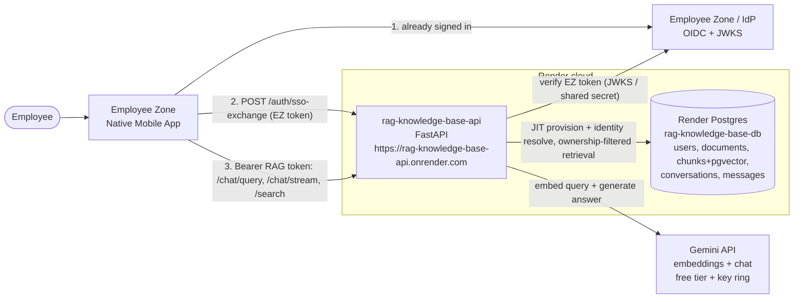
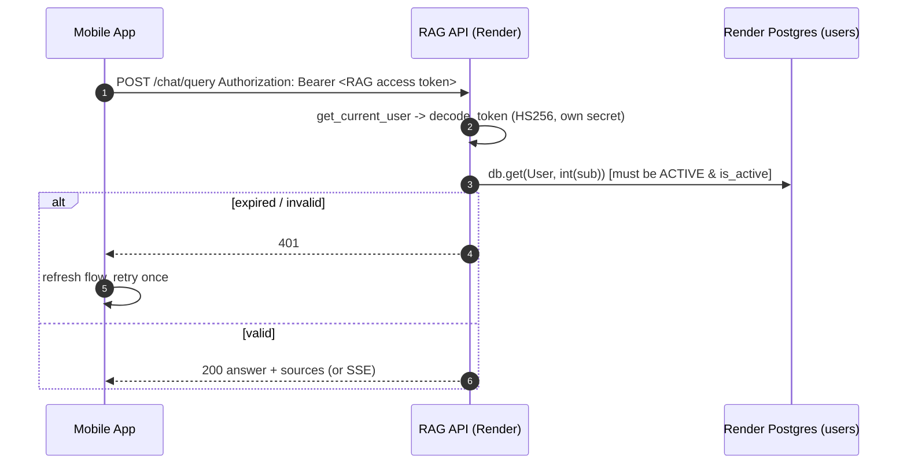
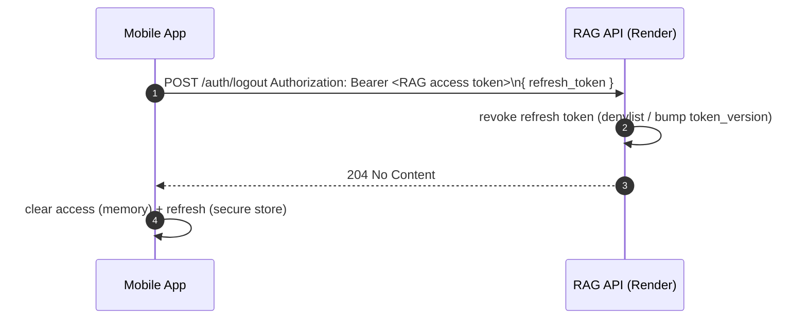

# Employee Zone — RAG Knowledge Base Integration Specification

> **Authoritative integration spec** handed to the Employee Zone mobile team. Consolidates the four
> design docs (`01-current-state.md`, `02-auth-sso-design.md`, `03-shared-kb-design.md`,
> `04-mobile-transport-ops.md`) into one implementation-ready document.
>
> **This is a SPEC. No application code is changed by this document.** Every code claim is grounded
> in the current source (file:line). What already exists vs. what must be built is called out
> explicitly throughout.
>
> **Deployment target:** the LIVE Render deployment — web service **`rag-knowledge-base-api`**,
> base URL **`https://rag-knowledge-base-api.onrender.com`** *(confirm this exact host in the Render
> dashboard before wiring the mobile app)*, backed by the **managed Render Postgres** database
> `rag-knowledge-base-db`. All endpoint examples below use this live HTTPS base URL.

---

## 1. Executive Summary (plain language)

What is changing and why, for a non-technical reader:

- **One login, not two.** Employees are already signed into the Employee Zone app. We will make the
  knowledge-base API *trust* that sign-in, so employees never type a second username/password to ask
  questions.
- **Everyone shares one company knowledge base.** Employees can only read the official, admin-curated
  company documents. They cannot see anyone else's private files, and they get the same shared answers.
- **Employees can ask, but never upload.** Asking questions is the only thing an employee can do.
  Uploading, deleting, or managing documents is blocked for them — only admins curate the knowledge base.
- **The mobile app talks to the API directly.** No middle server. The phone app calls the live API on
  Render over HTTPS and shows the answer plus which company document it came from.
- **Most of the data-protection work is already built.** The system already keeps each person's
  documents separate at the database level (multi-tenant isolation is *done*). We mainly need to flip
  employees into "company-documents-only" mode and shut the upload door for them.
- **Two real risks to plan around.** (1) The shared AI provider (Gemini, free tier on Render) can run
  out of daily quota and silently give weaker answers — we should add fair-use limits and a paid tier.
  (2) The Render service can "cold start" after idle, so the first request may be slow — we should keep
  it warm.
- **All changes deploy to Render.** New settings are entered in the Render dashboard, the database is
  the managed Render Postgres, and we must account for cold starts and the free-tier quota.

---

## 2. Fixed Decisions (locked, not up for re-litigation)

1. **Auth = SSO / trusted token.** The RAG API trusts the Employee Zone identity. There is **NO second
   login** for employees. Recommended mechanism: a token-exchange endpoint (`POST /auth/sso-exchange`).
2. **KB = shared company knowledge base.** Employees query **admin-curated global documents only**
   (`is_global = true`). No personal-document blend.
3. **Employees can ONLY ask questions.** They **CANNOT upload** (hard requirement) and cannot manage,
   list, or delete documents.
4. **Client = native mobile app calling the API directly.** No backend proxy in front of the RAG API.
5. **Deliverable = spec only.** No code changes are made now. This document is the implementation contract.
6. **Deployment = live Render service** `rag-knowledge-base-api` at
   `https://rag-knowledge-base-api.onrender.com` *(confirm host in dashboard)*, managed Render Postgres,
   env vars set in the Render dashboard.

---

## 3. Target Architecture



Key points:
- The mobile app authenticates to the **IdP / Employee Zone** out of band, then exchanges that identity
  for a **RAG-issued token** at the live Render API. All subsequent calls use the RAG token.
- The RAG API and Postgres are both on Render. Postgres is the **managed Render DB** — connection via the
  `DATABASE_URL` secret set in the Render dashboard (`render.yaml:56-57`, `sync: false`).
- Gemini is an external provider; on the live deploy `EMBEDDING_PROVIDER=gemini`, `LLM_PROVIDER=gemini`,
  `GEMINI_MODEL=gemini-2.5-flash-lite` (`render.yaml:29-38`).

---

## 4. Authentication & Identity Federation

### 4.1 Current state (what exists today)

- Auth is a **self-issued HS256 JWT** with claims `{"sub": str(user_id), "role": role, "exp": expire}`
  minted by `create_access_token` (`backend/app/core/security.py:65-76`) and decoded with the same
  shared secret (`backend/app/core/security.py:79-82`). `sub` is the **user id**, not the email.
- `JWT_SECRET_KEY` default `"dev-secret-change-me-in-production"`, `JWT_ALGORITHM="HS256"`
  (`backend/app/core/config.py:98-99`). On the live deploy `JWT_SECRET_KEY` is a Render secret
  (`render.yaml:60-61`).
- `get_current_user` (`backend/app/core/security.py:86-96` → `_resolve_user_from_token`, `:105-127`)
  decodes the token, does `int(sub)`, then `db.get(User, user_id)` against the **users table**; rejects
  missing / `status != ACTIVE` / `is_active == False` with 401. Every protected request hits the DB once.
- Token lifetime is **720 min / 12h** (`ACCESS_TOKEN_EXPIRE_MINUTES`, `backend/app/core/config.py:100`;
  the live deploy sets `720` in `render.yaml:41-42`). **There is no refresh token** (grep finds only
  ORM `db.refresh`).
- `POST /auth/login` (`backend/app/api/auth.py:45-59`, OAuth2 password form, `username`=email) and a
  **public** `POST /auth/register` gated by `ALLOW_REGISTRATION` (default **`True`**,
  `backend/app/core/config.py:97`) exist. An admin is idempotently seeded on every boot
  (`_seed_admin_user`, `backend/app/main.py:37-55`).

**The gap:** the API only trusts JWTs it issued itself, against its own users table. An Employee
Zone-issued token does not validate, and there is no JIT user-provisioning path.

### 4.2 Recommended model — Option A: Token Exchange (PRIMARY)

The RAG API exposes a new `POST /auth/sso-exchange`. The mobile app sends its Employee Zone (EZ) token;
the RAG API **verifies it once**, JIT-provisions/reconciles a `users` row, and returns a **RAG-issued
access token + refresh token**. All `/chat/*` and `/search` calls then use the RAG token, so
`get_current_user` works **untouched** (`sub = str(user.id)`, resolved against the users table exactly
as today, `backend/app/core/security.py:116-127`).

**Why Option A (decisive, code-grounded):**
1. **Smallest blast radius on the hot path.** Every chat/search request runs `get_current_user` which
   today does one `db.get(User, id)`. Option A keeps that path **byte-for-byte** — verification logic
   lives in **one new endpoint**, not on every request. No per-request JWKS fetch.
2. **Provider-agnostic.** Works whether the EZ token is RS256/JWKS, opaque-with-introspection, or an
   HS256 shared-secret token. We are not yet certain EZ exposes a standards-compliant JWKS.
3. **Full control of the long-lived credential** the mobile client holds (short, scoped, revocable).

**Rejected — Option C (service key + signed header):** requires a backend proxy; a service key in the
mobile client is a hard no. Documented only for a future proxied topology
(`02-auth-sso-design.md` §1 Option C).

### 4.3 OIDC / JWKS alternative — Option B (config swap, not a rewrite)

The verifier is designed to be **pluggable**. If the company confirms a real IdP (Entra ID, Okta,
Auth0, Keycloak, Google Workspace) with the RAG API registered as an **audience**, we can flip to
Option B: point the chat-path bearer dependency at `get_current_employee` (which calls the **same**
`_verify_employee_zone_token`), drop the RAG access/refresh tokens, and the app sends its IdP token
directly. **Only the request-path dependency wiring changes** — verifier, provisioning, and config are
reused.

### 4.4 EZ token verification (`_verify_employee_zone_token`)

Two profiles, selected by config; both additive, never run unless SSO is configured.

**Profile 1 — Asymmetric / OIDC (preferred, RS256 + JWKS):**
- **Algorithm pinned** to `["RS256"]` — never `none`, never HS* with a public key (alg-confusion attack).
  The existing internal decode stays HS256 (`backend/app/core/security.py:82`); never mix key material.
- **Keys:** fetch IdP JWKS from `SSO_JWKS_URL`, select by token `kid`; cache JWKS in-process with TTL,
  **refetch on `kid` miss** (handles rotation without restart).
- **Issuer:** require `iss == SSO_ISSUER` (exact).
- **Audience:** require `SSO_AUDIENCE` present in `aud` (guards against audience confusion — a token
  minted for another EZ service must not be accepted). Prefer an **access token audienced to the RAG
  API**, not an ID token.
- **Expiry / nbf / iat** verified, with `SSO_CLOCK_SKEW_SECONDS` (default 60s) leeway.
- **Identity claims:** stable subject preferred order `employee_id` (`SSO_EMPLOYEE_ID_CLAIM`) else `sub`;
  `email` required for provisioning; optional `name`.

**Profile 2 — Symmetric (fallback only if EZ cannot expose JWKS):** verify HS256 with
`EMPLOYEE_ZONE_SHARED_SECRET` (server-side only, never in the mobile client), same iss/aud/exp/skew
checks. Stopgap; Profile 1 strongly preferred.

On **any** verification failure → generic `401` (do not leak which check failed; mirrors
`_CREDENTIALS_EXCEPTION`, `backend/app/core/security.py:31-35`).

### 4.5 JIT provisioning + reconciliation (`user_service.provision_employee`)

Performed once per exchange:
1. **Resolve identity key** = verified `email`, normalized via existing `normalize_email`
   (`backend/app/services/user_service.py:31-33`; `users.email` is CITEXT, case-insensitive). Optionally
   store `employee_id`/`sso_subject` as a stable secondary key (schema note, §8).
2. **Look up** by email (`get_user_by_email`, `:36-42`).
3. **JIT-create if absent:** `role="user"`, `is_active=True`, `status=ACTIVE`, with an **unusable
   password placeholder** so the email/password `authenticate_user` path (`:104-117`) can never succeed
   for an SSO account (`verify_password` returns `False` on a malformed hash,
   `backend/app/core/security.py:50-61`).
4. **Reconcile on every login:**
   - If the row was disabled RAG-side (`status != ACTIVE` / `is_active == False`) → **return 403**
     (respect off-boarding; do not silently re-activate).
   - Keep email/name in sync (optional, low-risk).
   - **Never elevate role from SSO claims** — SSO employees are always `role="user"`. Admin remains the
     seeded local account (`backend/app/services/user_service.py:138-194`).
5. **Return** the `User`; the endpoint mints RAG tokens via the existing `create_access_token`.

### 4.6 Token lifecycle

- **Short access token** in prod: drop `ACCESS_TOKEN_EXPIRE_MINUTES` from **720** to **~15** (the live
  `render.yaml:41-42` value is 720 — update it in the Render dashboard). Small theft window.
- **Refresh token** `REFRESH_TOKEN_EXPIRE_MINUTES` (~7 days, or aligned to EZ session) with a
  `typ:"refresh"` claim so it can't be used as an access token. Stored in iOS Keychain / Android Keystore.
- On a `401` from a chat call, the app **silently refreshes (or re-exchanges) and retries once**. For
  `/chat/stream`, the 401 arrives as the initial HTTP response (auth checked at request entry), so the
  retry is a clean re-POST — no partial-stream recovery. The conversation is server-persisted
  (`conversation_id` in the SSE `done` frame), so re-POSTing with the same `conversation_id` continues.
- **Re-exchange on EZ session refresh** so reconciliation re-runs (catches off-boarding/role changes).
- **Logout / revocation:** `POST /auth/logout` revokes the refresh token. Stronger posture: per-user
  `token_version` or `jti` denylist checked in `get_current_user`; admin `set_active(False)`
  (`backend/app/services/user_service.py:197-205`) for urgent off-boarding.

### 4.7 Sequence diagrams

**Login → token exchange:**
```mermaid
sequenceDiagram
    autonumber
    actor Emp as Employee
    participant App as EZ Mobile App
    participant EZ as Employee Zone / IdP
    participant RAG as RAG API (Render)
    participant DB as Render Postgres (users)

    Emp->>App: Open RAG feature (already signed into EZ)
    App->>RAG: POST /auth/sso-exchange { employee_zone_token }
    RAG->>EZ: GET JWKS (SSO_JWKS_URL) [cached; refetch on kid miss]
    EZ-->>RAG: JWKS public keys
    RAG->>RAG: verify EZ token: alg=RS256 pinned, iss, aud, exp(+skew), sig
    alt invalid / wrong iss|aud|exp|sig
        RAG-->>App: 401 (generic)
    else valid
        RAG->>DB: get_user_by_email(email)
        alt missing
            RAG->>DB: JIT create User(role=user, unusable pw, ACTIVE)
        else exists
            RAG->>DB: reconcile (active/status; sync email/name)
        end
        alt disabled / off-boarded
            RAG-->>App: 403
        else active
            RAG->>RAG: create_access_token(~15m) + create_refresh_token(~7d)
            RAG-->>App: 200 { access_token, refresh_token, expires_in }
        end
    end
    App->>App: store access (memory) + refresh (secure store)
```

**Authenticated chat (unchanged hot path):**


**Refresh + re-exchange:**
```mermaid
sequenceDiagram
    autonumber
    participant App as Mobile App
    participant RAG as RAG API (Render)
    participant EZ as Employee Zone / IdP
    participant DB as Render Postgres (users)

    Note over App,RAG: access token near/at expiry (or 401 mid-conversation)
    App->>RAG: POST /auth/refresh { refresh_token }
    RAG->>RAG: decode_refresh_token (typ=refresh, not expired, not revoked)
    RAG->>DB: reload user; ensure ACTIVE & is_active
    alt refresh valid & user active
        RAG->>RAG: mint new access (+ rotate refresh)
        RAG-->>App: 200 { access_token, refresh_token, expires_in }
        App->>RAG: retry original /chat request
    else refresh dead / user disabled
        RAG-->>App: 401 (or 403 if disabled)
        App->>EZ: obtain current EZ token
        App->>RAG: POST /auth/sso-exchange { employee_zone_token }
        RAG-->>App: 200 new token pair (full re-verify + reconcile)
    end
```

**Logout:**


---

## 5. Shared Company KB & Data Isolation

### 5.1 What is ALREADY built (do not re-build)

**Multi-tenant document isolation is fully implemented in code** (not just designed):
- `Document` carries `owner_id: int | None` (FK `users.id`, indexed, NULL = not user-owned,
  `backend/app/models/document.py:28-33`) and `is_global: bool` (default false, `:35-37`).
- **Default-deny SQL filter** lives in the vector-store JOIN: `_ownership_clause(owner_id, include_global)`
  builds `OR(Document.owner_id == owner_id, Document.is_global.is_(True))`, returning literal `false()`
  when `owner_id is None` **and** `include_global is False`
  (`backend/app/vectorstore/pgvector_store.py:33-50`). Applied in **both** retrieval paths — vector
  `query` (`:124-129`) and lexical-rescue `keyword_query` (`:210-215`). Single chokepoint for isolation.
- `search_service.search` threads `owner_id`/`include_global` into both SQL paths
  (`backend/app/services/search_service.py:358-365`, calls `412-414`, `443-449`). **No change needed.**
- **The store already supports global-only mode:** `owner_id=None, include_global=True` reduces the
  clause to `is_global IS TRUE` — exactly "global documents and nothing else."

**The gap is small:** no chat/search caller invokes the global-only mode for an authenticated user; the
source-display rule hides globals; and the upload route is open to any authenticated user.

### 5.2 Global-only retrieval for employees (policy, not a client flag)

Introduce a single server-side helper — **NEW `backend/app/core/access.py`**:

```python
GLOBAL_ONLY = (None, True)        # owner_id=None, include_global=True -> globals only
def retrieval_scope(user) -> tuple[int | None, bool]:
    if user.role == "admin":
        return (user.id, True)    # admin keeps own + global (unchanged)
    return GLOBAL_ONLY            # employee: globals only, NO personal blend
```

Scope is **derived from the server-verified identity/role**, never client-supplied (a client flag would
be a privilege-escalation vector). It feeds the already-implemented default-deny clause.

**Where it is applied (covers BOTH `/chat/query` and `/chat/stream`):**
1. `backend/app/api/chat.py` — compute `owner_id, include_global = retrieval_scope(current_user)` in
   `chat_query` (`:50-79`) and `chat_stream` (`:90-121`); pass both into chat_service.
2. `chat_service.query` / `stream_answer` (`backend/app/services/chat_service.py:700-708`, `591-598`) —
   add an `include_global` kwarg; forward to `_retrieve_and_build_prompt`.
3. `chat_service._retrieve_and_build_prompt` (`:501-517`) — replace the **hardcoded
   `include_global=True`** (line 516) with the threaded value; pass the threaded `owner_id` (None for
   employees) into `search_service.search`. Both chat entrypoints funnel through this one function.
4. `search_service.search` / `pgvector_store` — **no change** (already thread the scope).
5. `backend/app/api/search.py` (`:43-49`) — apply the **same** `retrieval_scope` so `/search` can't be a
   side channel to read personal docs; or lock it behind admin if not exposed to employees.

### 5.3 Block employee uploads & document management (hard requirement)

Default rule: **employees get chat read-only.** Every document-management endpoint that today accepts
any logged-in user must become **admin-only** (`require_admin` / `get_current_admin`).

| Endpoint | Current dep | Change |
|---|---|---|
| `POST /documents/upload` (`documents.py:118-124`) | `get_current_user` | **`get_current_admin`** — employees MUST NOT upload |
| `GET /documents` (`:273-277`) | `get_current_user` | `get_current_admin` |
| `GET /documents/{doc_id}` (`:292-296`) | `get_current_user` | `get_current_admin` |
| `DELETE /documents/{doc_id}` (`:305-309`) | `get_current_user` | `get_current_admin` |
| `POST /documents/{doc_id}/reindex` (`:320-325`) | `get_current_user` | `get_current_admin` |
| `GET /documents/{doc_id}/file` (`:154-158`) | `get_current_user_query_or_header` | Keep authed, restrict employees to **global docs only** |

Two implementations (either acceptable; **(b) recommended**):
- **(a)** Per-route dep swap to `get_current_admin`.
- **(b)** Move management routes onto the existing `admin_router` (already
  `dependencies=[Depends(get_current_admin)]`, `documents.py:58-62`), leaving on `public_router` only
  the employee-safe global file-serve. Makes "admin-only by default" structural. **Watch route ordering**
  (`documents.py:114-117`): literal paths (`/upload`, `/global`) before `/{doc_id}` routes.

`POST /documents/global` (admin-only, `owner_id=None, is_global=True`, `documents.py:243-266`) is the
**correct, unchanged** path for KB curation. There is **no anonymous-upload router** to disable —
`public_router` already requires `get_current_user` on every route (`documents.py:45-55`).

For `GET /documents/{doc_id}/file`: replace `_owner_scope(current_user)` (`documents.py:179`) with the
§5.2 scope so an employee serves **only `is_global` docs** (a non-global/foreign id 404s identically —
no existence leak, `documents.py:181-182`).

### 5.4 Show global sources (the required `_build_sources` change)

Today `_build_sources` **hides** global docs — a hit shows only if `is_global == False AND owner_id ==
<owner_id>` (`chat_service.py:296-314`, skip at line 314). In global-only mode that yields an **empty
sources list** for every employee answer. Required: the global doc that grounded the answer **IS shown**.

Make the predicate **scope-aware** (`show_global` param):
- **Employee / global-only (`owner_id is None`):** show **global** hits (`is_global == True`), never any
  non-global hit.
- **Admin / own+global:** keep existing own-docs-only display (or also show globals — admin choice; does
  not affect employee safety).

`_retrieve_and_build_prompt` passes `show_global = (owner_id is None)` into `_build_sources`. Dedup by
`(document_id, excerpt)`, no score emitted, retrieval order preserved — all unchanged. The
`Source` schema and SSE `done` frame are unchanged; employees simply now receive non-empty `sources`
pointing at global KB documents.

**Why this is safe:** widening citations to globals is safe *because* employee-mode retrieval can only
ever return global hits (§5.2) — there is nothing unsafe to surface. Display is a refinement on top of
SQL isolation, never a substitute for it. Guard: `show_global=True` only when `owner_id is None`.

### 5.5 Admin curation & quota implications (Render + Gemini free tier)

- Embedding is the bottleneck and is **admin-side only**. Free-tier `embedContent` is paced:
  `GEMINI_EMBED_RPM=10`, `GEMINI_EMBED_MAX_RETRIES=6`, backoff base `0.5s` cap `60s`,
  `INDEXING_STALE_MINUTES=120` (`backend/app/core/config.py:50-57`). **Real ceiling ≈ 1000 embed
  requests/DAY.** An 80-page handbook chunked at ~500 chars (`CHUNK_SIZE=500`, `render.yaml:45-46`) is
  hundreds of chunks = hundreds of embed calls — **one or two big handbooks can exhaust the daily cap.**
- **Provider/dimension must match.** The query embedder and stored chunk embedder MUST be the same
  provider + `EMBEDDING_DIM` (live: `gemini`, `384`, `render.yaml:29-32`). A half-migrated index means
  semantic/paraphrased queries return nothing while only keyword hits work (a correctness hazard).
- Ops guidance: index the KB off-hours batched across days under the daily cap; verify every global doc
  has `indexing_status="indexed"` and full `chunk_count` before exposing Employee Zone; de-duplicate
  global uploads (refresh = delete-then-reupload/reindex, not re-upload alongside); provision a
  paid/higher embedding tier or key ring before scaling.

---

## 6. Mobile Transport, CORS, Streaming, Rate-Limiting & Error Contract

### 6.1 CORS — non-issue for native

Native (non-webview) HTTP clients **ignore CORS** (browser-only control). `CORS_ORIGINS` (default
`["http://localhost:3000"]`, `backend/app/core/config.py:86`; live value is a Render secret,
`render.yaml:66-67`) is **irrelevant to direct native calls.** The security boundary is the **Bearer
JWT** (`backend/app/core/security.py:105-127`). Current config: `allow_credentials=True`,
`allow_methods/headers=*` (`backend/app/main.py:83-89`). Only add an explicit web origin if a
webview/companion-web surface ships, and **never** combine `allow_origins=['*']` with
`allow_credentials=True` (spec-forbidden, CSRF-class risk).

### 6.2 Streaming on mobile

- **Default to `POST /chat/query` (non-streaming)** for robustness: simple JSON decode, robust to
  backgrounding/proxy idle timeouts, no quota-amplifying reconnect-replay. **RECOMMENDED.**
- Offer `POST /chat/stream` only as an **opt-in foreground** "live typing" enhancement. It is a **Bearer
  POST**, NOT browser `EventSource`. Native clients must parse line-based `data:` frames manually:
  - `data: {"delta": "<token>"}\n\n` per token,
  - terminal `data: {"done": true, "sources": [...], "conversation_id": N, "message_id": M}\n\n`,
  - `data: {"error": "..."}\n\n` on failure (`backend/app/api/chat.py:122-127`).
  - Response headers: `Cache-Control: no-cache`, `X-Accel-Buffering: no`, `Connection: keep-alive`
    (`backend/app/api/chat.py:43-47`).
- There is **no `Last-Event-ID` resume**; reconnect re-runs the pipeline and **re-spends Gemini quota**.
  Use a hard inter-frame idle timeout (~30s) + overall cap, fall back to `/chat/query` on drop.

### 6.3 Rate-limiting & quota (highest-priority backend gap)

- **There is NO app-level rate limiting today** (no slowapi/limiter/throttle in `app/`). Concurrent
  employees or one abusive token can burn the shared Gemini free-tier daily quota fast.
- **Add** per-user (JWT `sub`) + global daily caps on `/chat/query`, `/chat/stream`, `/search`; raise
  `RateLimitError` → `429` with `Retry-After` (the `RateLimitError → 429` class already exists,
  `backend/app/utils/errors.py:61-64`); exclude GETs and `/health`.
- **Stop silent quota degradation.** Today on Gemini all-keys 429 the pipeline silently falls back to a
  weak local extractive provider (`backend/app/services/chat_service.py:338-385`). Instead return `429`
  (preferred) or tag `degraded: true` / `X-Answer-Source: local-fallback` so the client can warn the
  user. For a fleet, move chat to a **paid Gemini tier**; keep key-ring rotation + local LLM only as an
  **observable** emergency fallback.

### 6.4 Error contract (stable envelope)

Current envelope: `{"detail": <object>}` (`backend/app/utils/errors.py:68-69`). `detail` is sometimes a
string, sometimes a list (422) — brittle for a typed decoder. **Spec:** standardize a stable `code` enum
and make `detail` always a string for non-422. Status → client behavior map:

| Status | Meaning | Client action |
|---|---|---|
| 401 | token invalid/expired | refresh → re-exchange → retry once |
| 403 | disabled / not allowed (e.g. employee upload) | show "not permitted" |
| 404 | gone / foreign id | "not found" (no existence leak) |
| 422 | bad input | fix input (validation array) |
| 429 | rate-limited / quota | back off, honor `Retry-After` |
| 5xx / 502 | provider/server error | tap-to-retry |
| 503 | JWKS unavailable (exchange) | retry shortly |

### 6.5 Ergonomics & ops (recommended)

- **Versioning:** add `/api/v1` path prefix (mobile-pinnable; optionally keep unversioned aliases during
  transition).
- **Idempotency:** accept `Idempotency-Key` on chat POSTs, dedupe within a TTL; auto-retry GETs only,
  never chat POSTs blindly (timeout retries otherwise double-spend quota).
- **Pagination:** add `limit`/`offset` to `GET /chat/conversations` and message retrieval
  (`backend/app/api/chat.py:158-190`).
- **Request guards:** `MAX_QUERY_CHARS`, `MAX_HISTORY_TURNS`, global request-body byte cap.
- **Render cold starts:** `/health` exists (GET+HEAD, `backend/app/main.py`). Add an external
  **keep-warm pinger** on `HEAD /health` or run an always-on instance — a cold start on a streaming POST
  looks like a hang.
- **PII:** redact/`DEBUG`-gate raw query logging (`backend/app/api/chat.py:65-70, 107-112`); never log
  Bearer tokens or full answers.
- **Gate `/docs` + `/openapi.json`** in production (`EXPOSE_DOCS=False`).

---

## 7. API Contract Reference

All paths use the **live base URL** `https://rag-knowledge-base-api.onrender.com`
*(confirm host in the Render dashboard)*. Auth header on every protected call:
`Authorization: Bearer <RAG access token>`. (If `/api/v1` versioning is adopted, prefix `/chat`,
`/search`, `/documents` paths with `/api/v1`.)

### 7.1 Auth

#### `POST /auth/sso-exchange`  (NEW) — public
Exchange a verified EZ token for RAG tokens.
```http
POST https://rag-knowledge-base-api.onrender.com/auth/sso-exchange
Content-Type: application/json

{ "employee_zone_token": "<EZ JWT>" }
```
```json
200 OK
{
  "access_token": "<RAG HS256 access JWT>",
  "refresh_token": "<RAG HS256 refresh JWT>",
  "token_type": "bearer",
  "expires_in": 900
}
```
Errors: `400` malformed body · `401` EZ token invalid/expired/wrong iss|aud|sig (generic,
`WWW-Authenticate: Bearer`) · `403` mapped user disabled/off-boarded · `503` JWKS fetch failed, no cache.

#### `POST /auth/refresh`  (NEW) — public (refresh token in body)
```http
POST https://rag-knowledge-base-api.onrender.com/auth/refresh
Content-Type: application/json

{ "refresh_token": "<RAG refresh JWT>" }
```
`200 OK` same shape as exchange (new `access_token`, optionally rotated `refresh_token`, `expires_in`).
Errors: `401` invalid/expired/`typ != refresh`/revoked · `403` user disabled.

#### `POST /auth/logout`  (NEW, recommended)
```http
POST https://rag-knowledge-base-api.onrender.com/auth/logout
Authorization: Bearer <RAG access token>
Content-Type: application/json

{ "refresh_token": "<RAG refresh JWT>" }
```
`204 No Content`. Revokes the refresh token (and access via `jti`/`token_version` if implemented).

#### `GET /auth/me`  (UNCHANGED)
```http
GET https://rag-knowledge-base-api.onrender.com/auth/me
Authorization: Bearer <RAG access token>
```
Returns the safe identity (`backend/app/api/auth.py:62-65`); now also serves SSO-provisioned users.

#### `POST /auth/login` / `POST /auth/register`  (UNCHANGED, not the employee path)
Present but NOT the employee entry point. `register` is disabled in prod via `ALLOW_REGISTRATION=False`;
`login` remains for the seeded admin only.

### 7.2 Chat (UNCHANGED contract; behavior change = global-only for employees)

#### `POST /chat/query`  — primary, default for mobile
```http
POST https://rag-knowledge-base-api.onrender.com/chat/query
Authorization: Bearer <RAG access token>
Content-Type: application/json

{ "query": "What is the leave policy?", "top_k": 8, "conversation_id": 12, "history": [] }
```
```json
200 OK
{
  "answer": "Employees accrue 1.5 days of paid leave per month ...",
  "sources": [
    { "document": "HR_Handbook.pdf", "document_id": 7, "page": 14,
      "excerpt": "Paid leave accrues at 1.5 days per month ..." }
  ],
  "conversation_id": 12,
  "message_id": 88
}
```
Employee (`role="user"`): grounded **only** on `is_global=true` docs; `sources[]` now lists the global
docs that grounded the answer. Errors: `401` · `422` bad input · `429` (when rate-limiting added) ·
`502` provider error.

#### `POST /chat/stream`  — opt-in foreground streaming
```http
POST https://rag-knowledge-base-api.onrender.com/chat/stream
Authorization: Bearer <RAG access token>
Accept: text/event-stream
Content-Type: application/json

{ "query": "Summarize the travel policy", "conversation_id": 12 }
```
SSE frames (parse manually, not `EventSource`):
```
data: {"delta": "Employees "}

data: {"delta": "may book "}

data: {"done": true, "sources": [ ... ], "conversation_id": 12, "message_id": 89}
```
Failure: `data: {"error": "..."}`. A 401 arrives as the initial HTTP response (clean re-POST on retry).

#### Conversation CRUD (UNCHANGED, per-employee owner-scoped)
```http
POST   https://rag-knowledge-base-api.onrender.com/chat/conversations          -> 201 { id, ... }
GET    https://rag-knowledge-base-api.onrender.com/chat/conversations          -> 200 [ ... ]  (add ?limit&offset)
GET    https://rag-knowledge-base-api.onrender.com/chat/conversations/{id}     -> 200 { conversation, messages[] } | 404
DELETE https://rag-knowledge-base-api.onrender.com/chat/conversations/{id}     -> soft-delete
```
All require `Authorization: Bearer`. Foreign/missing id → `404` (no existence leak,
`backend/app/services/chat_service.py:548-557`).

### 7.3 Search

#### `POST /search`  (behavior change: employee scope = global-only, or admin-only)
```http
POST https://rag-knowledge-base-api.onrender.com/search
Authorization: Bearer <RAG access token>
Content-Type: application/json

{ "query": "expense reimbursement", "top_k": 8 }
```
`200 OK` list of hits. For an employee, results are restricted to `is_global=true` (no personal docs).

### 7.4 Documents (admin-only for management; employees read global file only)

| Method & path | Auth | Employee result |
|---|---|---|
| `POST /documents/upload` | admin only (changed) | **403** |
| `POST /documents/global` | admin only (unchanged) | 403 |
| `GET /documents` | admin only (changed) | 403 |
| `GET /documents/{id}` | admin only (changed) | 403 |
| `DELETE /documents/{id}` | admin only (changed) | 403 |
| `POST /documents/{id}/reindex` | admin only (changed) | 403 |
| `GET /documents/{id}/file` | authed; global-only for employees | 200 if global, else 404 |

Admin global upload example:
```http
POST https://rag-knowledge-base-api.onrender.com/documents/global
Authorization: Bearer <admin access token>
Content-Type: multipart/form-data

file=@HR_Handbook.pdf
```
Employee opening a cited global doc:
```http
GET https://rag-knowledge-base-api.onrender.com/documents/7/file
Authorization: Bearer <RAG access token>
```

### 7.5 Health
```http
GET  https://rag-knowledge-base-api.onrender.com/health   -> 200
HEAD https://rag-knowledge-base-api.onrender.com/health   -> 200   (use for keep-warm pinger)
```

---

## 8. Exact Change List (file-level)

Effort: **S** ≈ <0.5d, **M** ≈ 0.5–2d, **L** ≈ 2–5d. "ALREADY EXISTS" rows are confirmations, not work.

### MUST (required to ship Employee Zone)

| # | File | What | Why | Effort |
|---|---|---|---|---|
| 1 | `backend/app/core/config.py` | Add SSO settings: `SSO_ENABLED`, `SSO_ISSUER`, `SSO_AUDIENCE`, `SSO_JWKS_URL`, `SSO_ALGORITHMS=["RS256"]`, `SSO_EMPLOYEE_ID_CLAIM`, `SSO_CLOCK_SKEW_SECONDS=60`, `SSO_JWKS_CACHE_TTL_SECONDS=600`, `EMPLOYEE_ZONE_SHARED_SECRET`, `REFRESH_TOKEN_EXPIRE_MINUTES`. All default off. | Trust the EZ identity; back-compatible (no behavior change unless configured). | M |
| 2 | `backend/app/core/security.py` | Add `_verify_employee_zone_token(raw)->EmployeeClaims` (JWKS/RS256 + shared-secret profiles, alg pinning, iss/aud/exp/skew, JWKS cache+rotation); add `create_refresh_token`/`decode_refresh_token` (HS256, `typ:"refresh"`); add `get_current_employee` (Option-B seam). **Leave `create_access_token`, `decode_token`, `get_current_user`, `_resolve_user_from_token` unchanged.** | Verify external token without touching the hot path. | L |
| 3 | `backend/app/services/user_service.py` | Add `provision_employee(db, email, employee_id=None, name=None)->User` (JIT create role=user + unusable password; reconcile active/status each login; RAG-side disable → 403). Reuse `normalize_email`, `get_user_by_email`. | JIT provisioning + reconciliation. | M |
| 4 | `backend/app/api/auth.py` | Add `POST /auth/sso-exchange`, `POST /auth/refresh`, `POST /auth/logout`; wire exchange → verify → `provision_employee` → mint access+refresh. Leave login/register/me. | New employee auth surface. | M |
| 5 | `backend/app/schemas/` (new `auth.py` or extend `user.py`) | Add `SSOExchangeRequest`, `RefreshRequest`, `TokenPairResponse` (`access_token`, `refresh_token`, `token_type`, `expires_in`). Keep `LoginResponse`. | Request/response models. | S |
| 6 | `backend/app/core/access.py` (**NEW**) | `retrieval_scope(user)->(owner_id, include_global)`; `GLOBAL_ONLY=(None,True)`. Single source of truth: employees=globals only, admins=own+global. | Server-derived scope (no client flag). | S |
| 7 | `backend/app/services/chat_service.py` | `_retrieve_and_build_prompt` (`:501-517`): stop hardcoding `include_global=True` (line 516); forward threaded `owner_id`/`include_global`; pass `show_global=(owner_id is None)`. `query`/`stream_answer`: add `include_global` kwarg. `_build_sources` (`:296-335`): make predicate scope-aware (show globals to employees), keep dedup/order/no-score. | Global-only retrieval + show global citations, both `/chat/query` & `/chat/stream`. | M |
| 8 | `backend/app/api/chat.py` | `chat_query` (`:50-79`), `chat_stream` (`:90-121`): resolve `owner_id, include_global = retrieval_scope(current_user)`; pass both into chat_service. | Apply scope at API boundary. | S |
| 9 | `backend/app/api/search.py` | `search` (`:43-49`): resolve scope via `retrieval_scope` (or move endpoint behind admin). | Close the `/search` side channel. | S |
| 10 | `backend/app/api/documents.py` | Restrict `POST /documents/upload`, `GET /documents`, `GET/DELETE /documents/{id}`, `POST /documents/{id}/reindex` to `get_current_admin` (prefer moving onto `admin_router`; watch route ordering `:114-117`). Change `GET /documents/{id}/file` scope from `_owner_scope` (`:179`) to global-only for employees. | **Block employee uploads/management (hard requirement).** | M |
| 11 | Render dashboard env (`render.yaml`) | Set `ALLOW_REGISTRATION=False`; lower `ACCESS_TOKEN_EXPIRE_MINUTES` from `720` (`render.yaml:41-42`) to ~15; set strong `JWT_SECRET_KEY`, `ADMIN_PASSWORD`; add SSO_* + `REFRESH_TOKEN_EXPIRE_MINUTES`. Secrets are `sync:false` — set in dashboard, not committed. | Prod hardening + enable SSO on the live service. | S |
| 12 | `backend/app/services/search_service.py` | **ALREADY EXISTS — no change.** Confirmed it threads `owner_id`/`include_global` to both SQL paths (`:358-365`, `412-414`, `443-449`). | Confirm threading point. | — |
| 13 | `backend/app/vectorstore/pgvector_store.py` | **ALREADY EXISTS — no change.** Default-deny `_ownership_clause` (`:33-50`) in both retrieval paths. | Isolation already enforced in SQL. | — |

### SHOULD (operationally important for a fleet)

| # | File | What | Why | Effort |
|---|---|---|---|---|
| 14 | new rate-limit middleware/dep + `backend/app/core/config.py` | Per-user (JWT `sub`) + global daily caps on `/chat/query`, `/chat/stream`, `/search`; raise existing `RateLimitError`→429 + `Retry-After` (`utils/errors.py:61-64`). Config: `CHAT_RATELIMIT_PER_USER`, `CHAT_DAILY_PER_USER`, `CHAT_RATELIMIT_GLOBAL`, `RATELIMIT_BACKEND_URL`. | No throttle today; protect shared Gemini quota. | M |
| 15 | `backend/app/services/chat_service.py` (`:338-385`) | Stop silent local-LLM fallback: return `429` or tag `degraded:true` / `X-Answer-Source: local-fallback`. | Make quota exhaustion visible to the client. | M |
| 16 | Render config / Gemini | Move chat to a **paid Gemini tier**; keep key-ring rotation + local LLM only as observable emergency fallback. | Capacity for many concurrent employees. | S |
| 17 | `backend/app/utils/errors.py` + clients | Stable `code` enum; `detail` always a string for non-422 (`:68-91`). | Typed mobile decoder. | S |
| 18 | external pinger / Render | Keep-warm `HEAD /health` pinger or always-on instance. | Kill Render cold starts on streaming POSTs. | S |

### COULD (nice-to-have / future)

| # | File | What | Why | Effort |
|---|---|---|---|---|
| 19 | `backend/app/main.py` + routers | `/api/v1` path prefix (keep unversioned aliases during transition). | Mobile-pinnable version boundary. | M |
| 20 | `backend/app/api/chat.py` (`:158-190`) | Pagination (`limit`/`offset`) on conversation + message lists. | Bounded payloads. | S |
| 21 | chat POST handlers | `Idempotency-Key` header + TTL dedupe. | Prevent double-post/double-spend on retry. | M |
| 22 | `users` model + Alembic migration | Nullable `employee_id`/`sso_subject` column; key provisioning on it. **Email-only mapping needs NO schema change.** Requires `alembic upgrade head` (runs in Render `entrypoint.sh`). | Stable identity if EZ emails change. | M |
| 23 | `backend/app/api/chat.py` (`:65-70,107-112`) + config | `EXPOSE_DOCS=False`, `LOG_QUERIES`/PII redaction. | Reduce surface advertising + PII in logs. | S |

**Render deployment notes for the change list:**
- All env changes (items 11, 14, 16, 23) are set in the **Render dashboard** for service
  `rag-knowledge-base-api` (secrets are `sync:false` in `render.yaml` — never committed).
- DB changes (item 22) run as Alembic migrations against the **managed Render Postgres**
  (`DATABASE_URL` secret); the Docker `entrypoint.sh` runs `alembic upgrade head` on deploy.
- `autoDeploy: true` (`render.yaml:21`) means a push to the deployed branch redeploys; watch **cold
  starts** on the `starter` plan after deploys/idle.

---

## 9. Security Model & Threats

**Isolation guarantees:**
- **SQL default-deny is the primary isolation.** Employee retrieval (`owner_id=None,
  include_global=True`) reduces `_ownership_clause` to `is_global IS TRUE`
  (`pgvector_store.py:43-50`) — no personal/foreign chunk can enter the vector pool, keyword-rescue
  pool, or results. Enforced in the JOIN, not Python.
- **Scope is server-derived from role/identity**, never client-supplied → no escalation via request
  params (consistent with server-side `owner_id` stamping on writes, `documents.py:144`).
- **No write/list surface** for employees: all management endpoints admin-only (403).
- **Conversations remain per-employee** with 404-on-foreign (no existence leak).
- **Source visibility is a display refinement** layered on SQL isolation; widens citations to globals
  only, which are the only hits employees can retrieve.

**Auth threats & mitigations:**
- **Alg-confusion:** pin `SSO_ALGORITHMS=["RS256"]`; never accept `none`/HS-with-public-key; keep
  internal HS256 decode separate (`security.py:82`).
- **Audience confusion:** require `SSO_AUDIENCE` in `aud`, pin `iss`; prefer an access token audienced
  to the RAG API, not an ID token.
- **Token theft / replay:** short access TTL (~15m); refresh in secure store, rotation-on-use with
  reuse-detection; optional `jti`/`token_version` revocation. **HTTPS only** — never plain HTTP.
- **No secrets in the mobile client:** the app holds only the employee's EZ token + RAG tokens minted
  for that employee — never a service key, `EMPLOYEE_ZONE_SHARED_SECRET`, or `JWT_SECRET_KEY`.
- **Off-boarding latency:** still-valid RAG token (≤15m) works after EZ off-boarding; mitigate with
  short TTL + refresh revocation + admin `set_active(False)`.
- **Insecure defaults:** override `JWT_SECRET_KEY` (`"dev-secret-change-me-in-production"`,
  `config.py:98`), `ADMIN_PASSWORD`, `ADMIN_EMAIL` (`config.py:88-95`) in the Render dashboard.
- **Self-registration:** `ALLOW_REGISTRATION=False` in prod (default `True`, `config.py:97`).
- **Generic auth errors:** single generic 401 on verification failure (no leak of which check failed).

**Leakage vectors to watch:**
- Forgetting `/search` (becomes a personal-doc side channel if left on `owner_id=current_user.id`).
- A future retrieval caller hardcoding `include_global=True`/`owner_id=current_user.id` — route ALL
  retrieval through `retrieval_scope`.
- `_build_sources` over-widening — `show_global=True` only when `owner_id is None`.
- `/documents/{id}/file` left on `_owner_scope` (employee could fetch a legacy private file).
- **JIT employee accidentally provisioned `role="admin"`** — bypasses every guard; provisioning MUST
  mint `role="user"`.
- Half-migrated index (availability "leak": empty semantic answers).

**Transport:** native clients ignore CORS — boundary is the Bearer JWT; never `allow_origins=['*']` +
`allow_credentials=True`; gate `/docs` + `/openapi.json` in prod; don't log Bearer tokens / raw queries
/ full answers; map the in-band SSE `error` frame to a generic client message.

---

## 10. Rollout & Testing Plan

**Staging on Render:**
1. Stand up a staging copy (or a staging env on `rag-knowledge-base-api`) with SSO_* configured and
   `SSO_ENABLED=True`, `ALLOW_REGISTRATION=False`, `ACCESS_TOKEN_EXPIRE_MINUTES≈15`, strong secrets.
2. Run Alembic migration (if item 22 adopted) against staging Render Postgres; verify
   `alembic upgrade head` succeeds in `entrypoint.sh`.
3. Curate a small global KB via `POST /documents/global`; verify every doc `indexing_status="indexed"`,
   full `chunk_count`, and Gemini `EMBEDDING_DIM=384` coverage (no half-migrated index).

**Auth tests:** exchange happy path (valid EZ token → user provisioned, tokens returned); reject bad
`iss`/`aud`/`alg`/`exp`/signature; JWKS rotation (kid miss → refetch); refresh happy path + reject
access-token-as-refresh and refresh-as-access; reconciliation 403 for disabled user; **back-compat:**
existing email/password login + `get_current_user` tests still pass.

**Data-isolation tests (must-pass):**
1. Seed global G, employee A's legacy private PA, other employee B's private PB. As A, query a fact only
   in PA → answer must NOT contain it and `sources` must NOT reference PA; same for PB.
2. Fact only in G → answer grounded on G and `sources` lists G (validates `_build_sources`). Run for
   **both** `/chat/query` and `/chat/stream` (parse the SSE `done` frame's `sources`).
3. SQL-level: `owner_id=None, include_global=True` returns only `is_global` chunks;
   `owner_id=None, include_global=False` returns `[]` (default-deny).
4. Employee → `POST /documents/upload` returns **403**; same for `GET /documents`, `GET/DELETE
   /documents/{id}`, `POST /documents/{id}/reindex`.
5. Employee `GET /documents/{G}/file` → 200; `GET /documents/{PB}/file` → **404** (no existence leak).
6. No client-flag escape: passing `owner_id`/`include_global` in the body is ignored (server uses
   `retrieval_scope` only).
7. Regression: admin retains own+global retrieval and full management; no self-registered users exist.

**Load / quota:**
- Simulate concurrent employees; confirm rate limits return `429 + Retry-After` (after item 14) and that
  quota exhaustion is surfaced (degraded flag/429) rather than silent local fallback.
- Verify keep-warm pinger eliminates cold-start hangs on the first streaming POST.

**Cutover:** enable SSO behind a feature flag for a pilot group, watch 401/403/429/5xx + local-fallback
metrics, then expand. Roll back by disabling `SSO_ENABLED` (additive design → no behavior change).

---

## 11. Open Questions for the Employee Zone Team

1. **Exact EZ token format & claims:** is the EZ token a JWT? Which claims for `iss`, `aud`, `exp`,
   `kid`, `email`, and a stable `employee_id`/`sub`? Is it an access token or ID token (audience matters)?
2. **IdP / JWKS availability:** does EZ expose a standard `/.well-known/openid-configuration` + JWKS
   (RS256)? If yes, supply `SSO_JWKS_URL`, `SSO_ISSUER`, `SSO_AUDIENCE`. If not, do we use the HS256
   shared-secret fallback (Profile 2) or a token-introspection endpoint?
3. **Exact Render host:** confirm the production base URL is
   `https://rag-knowledge-base-api.onrender.com` (or the custom domain) in the Render dashboard.
4. **EZ email stability:** are employee emails stable and unique? If not, we need a stable
   `employee_id`/`sso_subject` mapping (schema migration, change-list item 22).
5. **Session length:** what is the EZ session lifetime, so we can align `REFRESH_TOKEN_EXPIRE_MINUTES`?
6. **Off-boarding signal:** how/when does EZ off-board an employee, and how quickly must RAG access be
   revoked (drives access TTL + revocation strategy)?
7. **Streaming requirement:** does the mobile UX require live token streaming, or is non-streaming
   `POST /chat/query` acceptable as the default?
8. **Expected concurrency / volume:** how many concurrent employees and queries/day, to size rate limits
   and decide on the paid Gemini tier?
9. **Admin role from EZ:** should any EZ group ever map to RAG admin, or is admin strictly the internal
   seeded account?

---

## 12. Effort Estimate & Phasing

| Phase | Scope | Change-list items | Effort |
|---|---|---|---|
| **Phase 0 — Render prep** | Set prod env (registration off, short token, strong secrets, SSO_* placeholders); curate + verify global KB; confirm host. | 11 | ~1d |
| **Phase 1 — SSO auth (MUST)** | Config + verifier + provisioning + endpoints + schemas; back-compat tests. Option A. | 1–5 | ~5–7d (S/M/L mix; item 2 is the L) |
| **Phase 2 — Shared-KB lockdown (MUST)** | `access.py`; chat/search scope; `_build_sources`; documents admin-only; isolation tests. | 6–10 | ~3–4d |
| **Phase 3 — Fleet hardening (SHOULD)** | Rate limiting, stop silent fallback, paid Gemini tier, error envelope, keep-warm. | 14–18 | ~3–4d |
| **Phase 4 — Ergonomics (COULD)** | `/api/v1`, pagination, idempotency, stable identity column, docs gating. | 19–23 | ~3–5d |

**Recommended go-live = Phases 0–2** (employees can log in via SSO, ask questions against the shared KB
only, cannot upload). **Phase 3 is strongly advised before a large fleet** rolls out (quota protection +
visible degradation). Phase 4 is incremental polish.

**Confirmed scope reminder:** multi-tenant document isolation is **already built** (Phase 2 is mostly
flipping employees into the existing global-only mode + closing the upload door + showing global
citations), and the chat/conversation contracts are **unchanged** for the mobile client.
